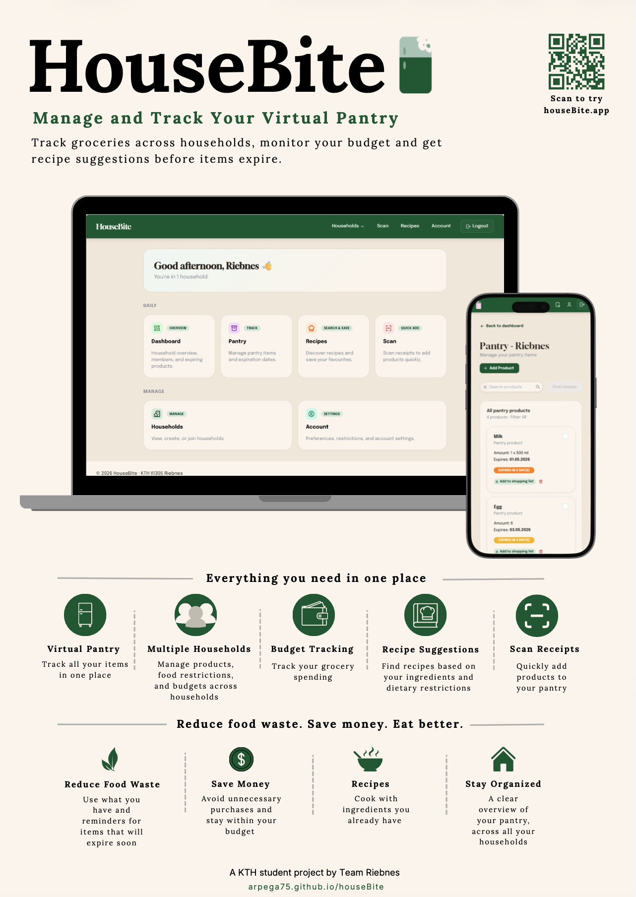
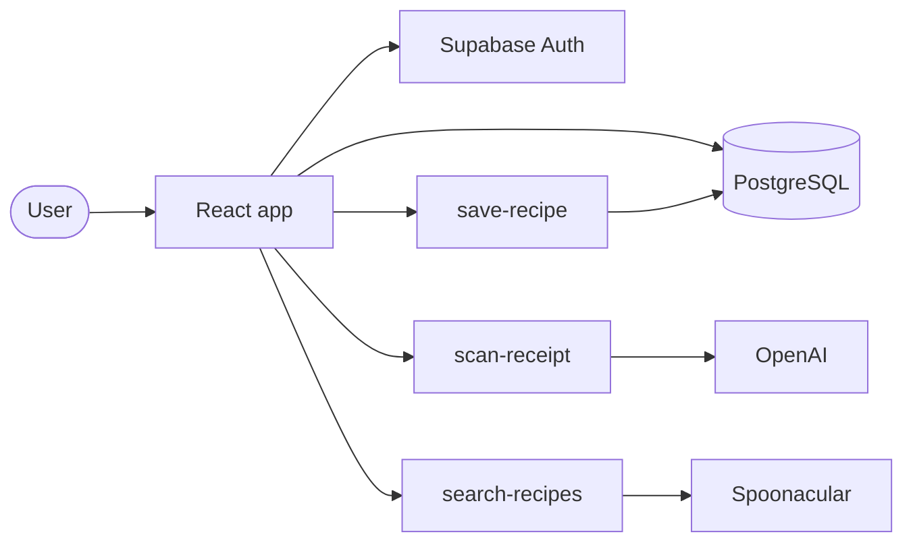

<div align="center">

# 🍽️ HouseBite

**Manage and track your virtual pantry**

[](https://housebite.app/)
[](https://arpega75.github.io/houseBite/)



</div>

## About

HouseBite is a web app for people who share food at home, like families or flatmates. You can keep track of what's in your pantry and when it expires, scan grocery receipts to add products, follow your household's budget, and find recipes that use what you already have.

We built it as a team of seven students for the course [Project in Information and Communication Technology (II1305)](https://www.kth.se/student/kurser/kurs/II1305) at KTH in spring 2026, working in Scrum sprints.
## Features

- Pantry with quantities, prices and expiry dates, and a warning for products that expire soon
- Receipt scanning: take a photo of a receipt and the products are added automatically (uses an OpenAI vision model)
- Recipe suggestions from [Spoonacular](https://spoonacular.com/food-api) based on selected products and the household's dietary restrictions
- Several households per user, joined with an invite code
- Shared shopping list that updates in real time
- Monthly budget and spending per member, with receipt history and Excel export
- Sign in with email or Google
- Can be installed as a PWA on mobile and desktop

## My part

- The household page: creating, joining, editing and leaving a household, the members list and the invite pop-up
- Dietary restrictions: changed the database design so restrictions match the ones Spoonacular uses, and built the preferences section on the Account page and the household restrictions modal
- Database functions for getting household members and their restrictions
- Sign-up page and Google sign-in
- Notifications and error messages across the app using Mantine
- Moved several pages over to Mantine components and redesigned the landing page
- Smaller features and fixes in the recipes, pantry, receipts and scan pages
- Refactoring, like moving repeated date and user code into shared helper files

## Tech stack

- **Frontend:** React 19, TypeScript, Vite, Mantine UI, React Router
- **Backend:** Supabase (PostgreSQL, Auth, Realtime, Row Level Security)
- **Edge Functions:** Deno, for receipt scanning and recipe search
- **APIs:** OpenAI, Spoonacular
- **Other:** Docker, Cloudflare (hosting), GitHub Actions

## How it works



The app doesn't have its own backend server. The React app talks directly to Supabase, and Row Level Security rules in the database make sure users can only see data from their own households. Things that need secret API keys, like receipt scanning and recipe search, run as Supabase Edge Functions. The database schema is kept as migration files in `supabase/migrations/`.

## Running locally

You need [Docker Desktop](https://www.docker.com/products/docker-desktop/) and the [Supabase CLI](https://supabase.com/docs/guides/cli).

```bash
git clone https://github.com/Sana8200/HouseBite.git
cd HouseBite

cp web/.env.example web/.env
supabase start
docker compose up --build
```

Then open http://localhost:5173.

To run only the frontend without Docker (needs Node.js):

```bash
cd web
npm install
npm run dev
```

Receipt scanning and recipe search also need API keys. See [docs/local-development.md](docs/local-development.md) for the full setup.

## Project structure

```
HouseBite/
├── web/                React + TypeScript frontend
│   └── src/
│       ├── pages/      App pages (dashboard, pantry, scan, recipes, ...)
│       ├── components/ Shared components
│       ├── api/        Functions that talk to Supabase
│       ├── hooks/      Custom React hooks
│       └── utils/      Helper functions
├── supabase/
│   ├── migrations/     Database schema
│   └── functions/      Edge Functions
└── docs/               Documentation
```

## Documentation

- [Local development](docs/local-development.md)
- [Database](docs/database.md)
- [Recipe search](docs/recipe-search.md)
- [Git workflow](docs/git-workflow.md)

## Team

Team Riebnes, KTH:

David Turesson, Sana Monhaseri, Samia Serbouti, Panayiotis Charalambous, David Gonçalves Bermúdez, Arnau Pelechano García, Beyza Baykan
