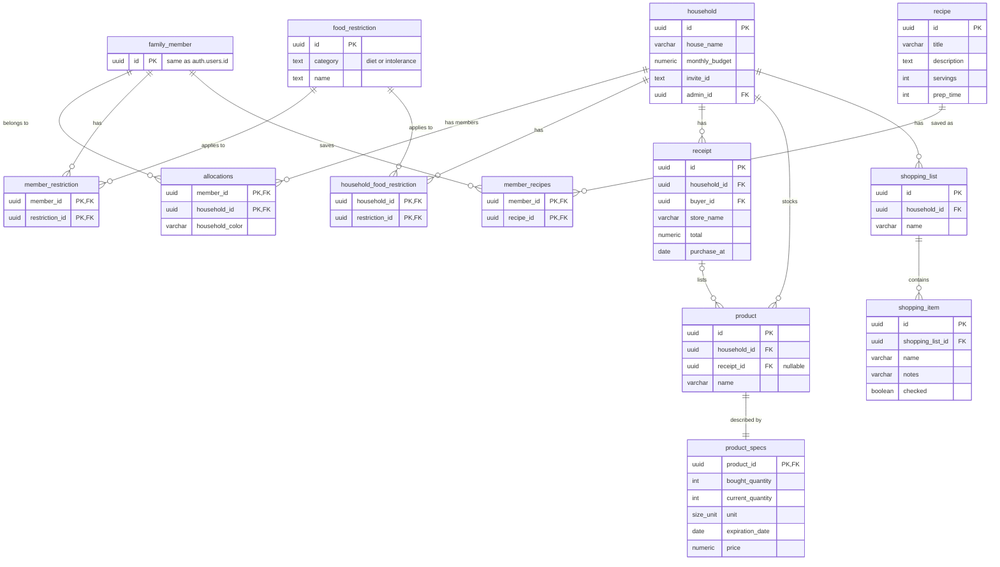

# Database

We use PostgreSQL through Supabase. The database stores households and their members, pantry products, receipts, shopping lists, dietary restrictions and saved recipes. All IDs are UUIDs so they match the user IDs from Supabase Auth.

The schema is built from the migration files in [`supabase/migrations/`](../supabase/migrations/). If you run `supabase db reset` locally, it rebuilds the database by running them in order.

## ER diagram

This is how the schema looks after all migrations:



Our first ERD from the planning phase is in [`images/erd-initial.png`](images/erd-initial.png). Some things changed later, but it shows where we started.

## Tables

| Table | What it stores |
|---|---|
| `household` | House name, monthly budget, invite code and admin |
| `family_member` | One row per user, linked to `auth.users`. Only the ID is stored here. Name, email and avatar come from Supabase Auth |
| `allocations` | Which users belong to which households, and the colour each user picked for that household |
| `food_restriction` | List of diets and intolerances, using the same names as Spoonacular |
| `member_restriction` | A user's own dietary restrictions |
| `household_food_restriction` | Restrictions for the whole household |
| `receipt` | A shopping trip: store, total, date and who paid |
| `product` | A food item in the pantry. Can be linked to the receipt it came from |
| `product_specs` | Quantity bought, quantity left, unit, expiry date and price of a product |
| `shopping_list` | A shopping list for a household |
| `shopping_item` | An item on a shopping list, with notes and a checkbox |
| `recipe` | A saved recipe: title, description, servings and prep time |
| `member_recipes` | Which user saved which recipe |

A few rules to keep in mind:

- A user can be in up to 5 households, and a household can have many users.
- A product always belongs to one household. If it was added by hand, it has no receipt.
- Every product has exactly one `product_specs` row.
- Saved recipes belong to a user, not to a household.

## Signup trigger

Supabase keeps users in its own `auth.users` table, so our `family_member` table doesn't know when someone signs up. To fix this, a trigger runs after every new signup and adds the user's ID to `family_member`:

```sql
CREATE OR REPLACE FUNCTION handle_new_user()
RETURNS trigger AS $$
BEGIN
  INSERT INTO public.family_member (id)
  VALUES (NEW.id);
  RETURN NEW;
END;
$$ LANGUAGE plpgsql SECURITY DEFINER;

CREATE OR REPLACE TRIGGER on_auth_user_created
  AFTER INSERT ON auth.users
  FOR EACH ROW EXECUTE FUNCTION handle_new_user();
```

The function needs `SECURITY DEFINER`, because the new user isn't logged in yet when it runs, so RLS would otherwise block the insert.

## Row Level Security

RLS is turned on for every table. This means the database itself decides who can see which rows, not only the frontend. Even someone with the public Supabase key can't read another household's data.

Most policies use this helper function, which returns the households the logged-in user belongs to:

```sql
CREATE FUNCTION my_households()
  RETURNS SETOF uuid AS $$
    SELECT household_id FROM allocations WHERE member_id = auth.uid()
  $$
```

| Table | Who can access |
|---|---|
| `household`, `receipt`, `product`, `shopping_list`, `household_food_restriction` | Members of that household |
| `product_specs`, `shopping_item` | Members of the household the parent row belongs to |
| `family_member`, `member_restriction`, `member_recipes`, `recipe` | Only the user themselves |
| `allocations` | Only the user's own memberships |
| `food_restriction` | Any logged-in user (it's a shared list) |

## Database functions

Some things are done in Postgres functions that the frontend calls with `supabase.rpc(...)`. We used these when we needed to read data from other users (like the names of household members), or when several changes had to happen together (like creating a household and adding the creator to it).

- Households: `create_household`, `join_household`, `transfer_admin`, `kick_member`, `kick_member_permanently`, `delete_orphan_household`
- Members: `get_household_members`, `get_household_member_names`, `get_household_member_count`
- Restrictions: `get_household_restrictions`, `get_household_distinct_restrictions`
- Budget: `get_household_budget_summary`, `get_household_member_spending`, `get_user_household_monthly_spending`
- Account: `delete_account`

There are also two views for the budget page: `household_stats` (total spent, average receipt and number of receipts) and `household_monthly_budget_summary` (spending per month compared to the budget).

## Limits

Since the app is public, we added some limits in the database and not only in the frontend:

- A user can be in at most 5 households, and a household can have at most 51 members.
- Display names can be at most 25 characters.
- Receipt scanning is rate limited to a set number of scans per minute, so the OpenAI costs can't get out of hand.
- The `receipt` table has a maximum number of rows. When it's full, the oldest ones are removed.

## Changing the schema

Don't edit a migration that has already been run. Add a new numbered file in `supabase/migrations/` and run `supabase db reset` locally. See [local-development.md](local-development.md#database-migrations) for more.
