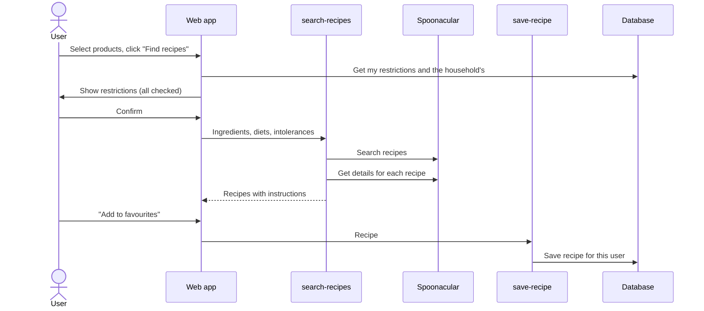

# Recipe Search

Users can select products from their pantry, for example things that expire soon, and get recipe ideas from [Spoonacular](https://spoonacular.com/food-api). The search takes into account the dietary restrictions of the user and the household, and recipes can be saved as favourites.

## How it works



1. On the Dashboard or Pantry page, the user selects some products and clicks *Find recipes*.
2. A pop-up (`RecipeSearchModal`) shows the user's own restrictions and the household's restrictions. They're all checked from the start, so nothing gets missed by accident, but the user can uncheck some for this search.
3. The `search-recipes` Edge Function asks Spoonacular for recipes that use those ingredients and match the restrictions. Then it fetches the full details for each recipe.
4. Recipes without step-by-step instructions are removed, and the rest are sent back to the app.
5. If the user clicks *Add to favourites*, the `save-recipe` function saves the recipe for that user.

## Edge Functions

Both functions only work for logged-in users. They check the user's token with `supabase.auth.getClaims`.

### `search-recipes`

The app sends:

```json
{
  "ingredients": "milk,eggs,flour",
  "household_id": "<uuid>",
  "diets": ["vegetarian"],
  "intolerances": ["peanut"]
}
```

What the function does:

1. Calls Spoonacular's `complexSearch` with the ingredients, diets and intolerances. It asks for 9 recipes, so there are some extra in case a few get removed later.
2. Calls `/recipes/{id}/information` for each recipe to get the instructions and nutrition. We had to do this separately because `complexSearch` doesn't always include the instructions.
3. Removes recipes that have no instructions.
4. Converts each recipe to the format we store in the database:

```json
{
  "title": "Pancakes",
  "description": "Calories: 320 kcal | Protein: 9 g | Fat: 12 g\n\n• 1 cup flour\n• 2 eggs\n...\n\n1. Mix dry ingredients.\n2. Add eggs and milk...",
  "servings": 4,
  "prep_time": 20
}
```

The `description` has three parts with a blank line between them: nutrition, ingredients and instructions.

### `save-recipe`

The app sends:

```json
{ "recipe": { "title": "...", "description": "...", "servings": 4, "prep_time": 20 } }
```

The function saves the recipe in the `recipe` table and links it to the user in `member_recipes`. The user ID is taken from the token, not from the request.

## Tables used

| Table | Used for |
|---|---|
| `recipe` | Saved recipes |
| `member_recipes` | Which user saved which recipe |
| `food_restriction` | All diets and intolerances (same names as Spoonacular uses) |
| `member_restriction` | The user's own restrictions, set on the Account page |
| `household_food_restriction` | The household's restrictions, set from the Dashboard |

## Local setup

We used Spoonacular through a proxy that the course gave us. Add the proxy details to `supabase/functions/.env` (this file is not committed):

```
SPOONACULAR_PROXY_URL=<proxy url>
SPOONACULAR_PROXY_KEY=<key>
```

Then run the functions on your machine (not in Docker):

```bash
supabase start
supabase functions serve --env-file supabase/functions/.env
```

If you forget `--env-file`, the search fails with *Missing proxy credentials*.

## Deploying

```bash
supabase secrets set SPOONACULAR_PROXY_URL=<proxy url> SPOONACULAR_PROXY_KEY=<key>
supabase functions deploy search-recipes
supabase functions deploy save-recipe
```
